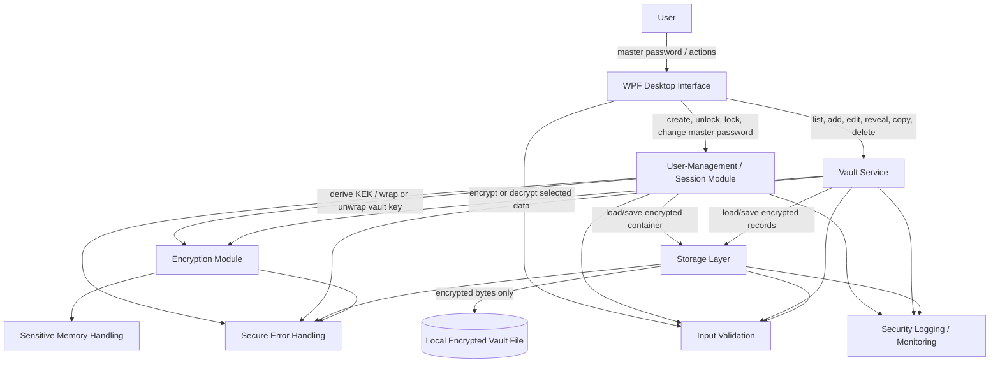

# Checkpoint 1 - Threat Model and Architecture

## Secure Desktop Password Manager
Project type: single-user offline desktop password manager  
Target: Windows desktop application using C# / .NET 10 and WPF  
Document: Checkpoint 1 - threat model and architecture

## 1. Scope and security goals
The first version stores credentials in one local encrypted vault. It has no server or network capability. The user runs the desktop application, enters a master password to unlock the vault, accesses credentials, and locks/closes the application when finished.

Primary goals:
1. Confidentiality: someone who copies the locked vault must not be able to read stored credentials without the master password.
2. Integrity: unauthorized modification of protected vault data must be detected and rejected.
3. Availability: failed saves, malformed input, or corruption should not silently destroy the last valid vault.
4. Authentication: the vault starts locked and is usable only after successful master-password authentication.
5. Minimize secret exposure: decrypted passwords and keys should remain in memory for the shortest practical time.

The design uses threat modelling, least privilege, defense in depth, fail-closed behavior, complete mediation, input validation, secure file I/O, a small attack surface, and testable security requirements.

### Security boundary and assumptions
The threat model assumes an attacker may:
- copy the vault file and perform unlimited offline password guesses;
- modify, replace, truncate, delete, or roll back the vault file;
- manipulate files/pathnames accessible to the same local user;
- supply malformed or extremely large UI/file input;
- read or modify local application logs;
- inspect process memory, swap, or crash artifacts if they obtain sufficient local access;
- use the application interface repeatedly while it is locked.

Version 1 cannot protect a secret that is already exposed on a fully compromised operating system. Administrator-level malware, keyloggers, screen capture, or unrestricted process-memory access are outside the protection boundary of the application.

## 2. Architecture


### 2.1 Desktop interface
Responsibilities:
- Create Vault, Unlock, Vault, Entry Details, and Security Settings screens;
- collect input and pass it to Core services;
- mask master/stored passwords by default;
- reveal/copy a password only after explicit user action;
- clear UI secret fields when the vault locks.

The UI does **not** implement cryptography or read/write the vault directly.

### 2.2 User-management / session module
"User management" in this offline project means management of the single local vault owner and authenticated session, not online user accounts.

Responsibilities:
- create the initial vault;
- start in the locked state;
- authenticate the master password by deriving a KEK and successfully unwrapping the vault key;
- keep the unlocked/locked state;
- require an unlocked session for every credential operation (complete mediation);
- automatically lock after inactivity;
- apply a short increasing delay after repeated UI unlock failures;
- change the master password by re-wrapping the vault key;
- clear active key material when locking.

There is no master-password recovery backdoor in version 1.

### 2.3 Encryption module
Responsibilities:
- generate cryptographically secure salts, keys, and nonces;
- derive a Key Encryption Key (KEK) from the master password using Argon2id;
- wrap/unwrap a random 256-bit vault key;
- encrypt/decrypt the vault index and credential records using AES-256-GCM;
- authenticate ciphertext before returning plaintext;
- use contextual additional authenticated data (AAD);
- clear temporary mutable key/plaintext buffers where practical.

Only established cryptographic libraries/APIs will be used.

### 2.4 Vault service
Responsibilities:
- list entries;
- add/edit/delete entries;
- retrieve a selected entry;
- request decryption only for data currently needed;
- keep encrypted records in application state where practical rather than holding all passwords plaintext for the entire unlocked session.

### 2.5 Input-validation module
All external data is treated as untrusted, including the application's own vault file because an attacker may modify it while the program is closed.

Validation occurs before expensive allocation, parsing, KDF work, or decryption where possible. It includes:
- maximum vault-file size;
- JSON depth/structure and required fields;
- supported format version;
- record-count limits;
- expected Base64 decoded lengths for salt/nonce/tag/key fields;
- valid record identifiers;
- bounded KDF parameters (memory, iterations, parallelism);
- bounded UI field lengths;
- rejection of malformed or ambiguous data rather than truncating security-critical input.

Passwords are not silently trimmed, normalized, or truncated because doing so could change the secret.

### 2.6 Storage layer

Responsibilities:
- store the vault in a fixed private application directory such as `%LOCALAPPDATA%\SecurePasswordManager\`;
- version 1 does not accept arbitrary user-selected vault paths;
- apply restrictive Windows file/directory permissions for the current user where supported;
- avoid shared directories for the vault and save-temporary files;
- create temporary save files with unpredictable names using exclusive creation (`CreateNew` semantics);
- write/flush a complete encrypted temporary vault and then use an OS-supported atomic replacement in the same directory;
- preserve the old valid vault if writing/replacement fails;
- never write plaintext credential data to temporary files.

This design avoids insecure "check pathname first, use it later" patterns as far as practical and reduces symbolic-link/reparse-point and race-condition exposure.

### 2.7 Security logging / monitoring
Planned fixed event types include:
- vault created;
- successful unlock;
- failed unlock attempt;
- manual/automatic lock;
- integrity/authentication failure;
- rejected malformed vault;
- save failure;
- unexpected application-error category.

Logs use fixed event IDs/messages and timestamps. No master password, stored password, username, URL, notes, cryptographic key, plaintext entry, or user-controlled free text is logged. Logs have owner-only access where practical and bounded size/rotation.

The log is local diagnostic and audit information. It is not tamper-proof: a local attacker with the user's file permissions may be able to edit or delete it.

### 2.8 Secure error handling
- Fail closed on authentication/integrity failures.
- Do not continue with unauthenticated data.
- Do not show stack traces, cryptographic details, keys, or sensitive paths to the user.
- Use generic messages for unlock/integrity failures.
- On a cryptographic/session-critical exception, lock the vault and clear transient secrets where practical.
- A failed save must not partially replace the current valid vault.

## 3. Main data flows

### 3.1 Create vault

```text
Master password
    |
    v
Validate input
    |
    v
Argon2id(password + random salt) -> KEK
    |
    +--> generate random 256-bit vault key
    |
    +--> AES-256-GCM wrap vault key with KEK
    |
    +--> create encrypted empty index
    |
    v
Storage writes encrypted vault atomically
    |
    v
Clear temporary password/KEK buffers where practical
```

### 3.2 Unlock

```text
Read small public header
    |
    v
Validate file size, format, encoded lengths and KDF parameter bounds
    |
    v
Master password -> Argon2id -> KEK
    |
    v
Authenticate + decrypt wrapped vault key
    |
    +-- failure --> remain locked; generic error; security event
    |
    v
Authenticate + decrypt vault index
    |
    v
Session becomes unlocked
```

A separate stored master-password hash is unnecessary: successful authenticated decryption of the wrapped vault key verifies the password.

### 3.3 Open an entry

```text
User selects entry
    |
    v
Verify session is unlocked
    |
    v
Validate record metadata / locate encrypted record
    |
    v
AES-GCM authenticate + decrypt selected record
    |
    v
Display/copy only on explicit action
    |
    v
Clear temporary plaintext buffers when no longer needed
```

### 3.4 Save an entry

```text
New/edited entry
    |
    v
Validate required fields and length limits
    |
    v
Encrypt record with a fresh nonce
    |
    v
Update authenticated encrypted index
    |
    v
Create unpredictable temporary file exclusively in private directory
    |
    v
Write + flush complete encrypted vault
    |
    v
Atomically replace previous vault
```

## 4. Threat model

### 4.1 Master password

| Threat | Security effect | Intended mitigation |
|---|---|---|
| Weak master password / offline guessing | Confidentiality | Argon2id with unique random salt and intentionally expensive parameters; minimum-length/strength guidance. |
| Modified KDF parameters force huge resource use | Availability | Validate/cap KDF memory, iteration, and parallelism values **before** running Argon2id. |
| Master password accidentally stored/logged | Confidentiality | Never persist or log it; use it only for KDF input; clear temporary mutable representations where practical. |
| Repeated UI guesses | Authentication / availability | Short increasing delay after failures; no permanent lockout. Offline resistance still comes from Argon2id. |
| Keylogger / compromised OS / shoulder surfing | Confidentiality | Mask input, minimize use time, auto-lock; document that a compromised OS is outside the full protection boundary. |
| Recovery/backdoor bypasses encryption | Confidentiality / authentication | No password-recovery backdoor. Losing the master password can make the vault unrecoverable. |

### 4.2 Vault at rest

| Threat | Security effect | Intended mitigation |
|---|---|---|
| Vault file stolen | Confidentiality | Credentials encrypted with a random vault key; vault key wrapped by an Argon2id-derived KEK. |
| Ciphertext/tag modified | Integrity | AES-256-GCM; authentication failure causes rejection. |
| Record removed, swapped, or replaced | Integrity | Authenticated encrypted index lists expected record IDs and ciphertext digests; mismatch is rejected. |
| Critical header malformed/tampered | Integrity / availability | Strict format/version/length validation; version 1 uses fixed algorithms, not attacker-selected algorithm names. Unwrap/authentication must still succeed. |
| Nonce reuse | Confidentiality / integrity | Fresh cryptographically random 96-bit nonce for every AES-GCM operation under a key. |
| Partial write / crash during save | Availability / integrity | Complete encrypted temporary write + flush + atomic replacement; preserve old vault until replacement succeeds. |
| Vault readable by another local OS user | Confidentiality | Private application directory and restrictive OS permissions; encryption remains primary protection. |
| Path redirection, symlink/reparse point, filename race | Integrity / confidentiality | Fixed private directory; no arbitrary vault path; unpredictable `CreateNew` temporary files; avoid check-then-use operations. |
| Whole-vault rollback to an older valid copy | Integrity / freshness | Known limitation: AEAD cannot distinguish a complete older valid vault without trusted state outside the vault. |
| Vault deletion/ransomware | Availability | Cannot be prevented by encryption; preserve safe saves and allow encrypted backups later. |

### 4.3 Vault in memory

| Threat | Security effect | Intended mitigation |
|---|---|---|
| Entire vault remains plaintext while unlocked | Confidentiality | Keep records encrypted in application state where practical; decrypt selected records on demand. |
| Secrets copied into immutable strings / remain after use | Confidentiality | Avoid unnecessary secret `string` copies; prefer mutable byte/char buffers for cryptographic secrets and clear them with explicit zeroing APIs where practical. |
| Swap, hibernation, crash dump | Confidentiality | Minimize secret lifetime; do not create application plaintext temp files; document OS-level limits. Full-disk encryption is defense in depth. |
| Memory corruption / unsafe code | Confidentiality / integrity / availability | Use managed C#, bounds-checked APIs, avoid `unsafe` code unless justified/reviewed, validate sizes before allocation, and audit dependencies. |
| Application left unlocked | Confidentiality | Inactivity auto-lock plus manual lock; remove active vault-key/session references when locking. |

Managed-runtime limitation: C#/.NET reduces many classic C/C++ memory-safety bugs, but it cannot guarantee that every historical plaintext copy has been physically overwritten immediately. Memory clearing is therefore best effort and secret lifetime is minimized by design.

### 4.4 Interface and input

| Threat | Security effect | Intended mitigation |
|---|---|---|
| Malformed/oversized input | Availability / integrity | Allow-list expected structure; bounded lengths/counts/depth; reject invalid values before allocation/processing. |
| Input used as a command/format/log template | Integrity / confidentiality | No shell execution; fixed logging templates/event IDs; user data is data, never a format string or command. |
| Password visible on screen | Confidentiality | Mask by default; temporary explicit reveal only. |
| Clipboard leakage/history | Confidentiality | Copy only on explicit action; clear after a short timeout only if clipboard still contains the application's copied value; document clipboard limitations. |
| Detailed errors reveal internals | Confidentiality | Generic UI errors; sanitized local diagnostic categories only. |
| UI bypasses authentication state | Authentication / authorization | Core services check session state for every protected operation; do not trust button visibility as access control. |
| Accidental network/telemetry exposure | Confidentiality | Version 1 contains no networking, sync, analytics, telemetry, or remote API. |

### 4.5 Logging, errors, build and dependencies

| Threat | Security effect | Intended mitigation |
|---|---|---|
| Sensitive data leaks into logs | Confidentiality | Security-event allow-list; never log vault fields or secret/key values. |
| Log forging/injection | Integrity | Fixed event IDs/messages; no user-controlled free-text log entries; sanitize control characters if any external value is ever recorded. |
| Log grows without bound | Availability | Size limit and rotation. |
| Local attacker edits/deletes logs | Audit integrity | Restrictive file permissions; document that local logs are not tamper-proof. |
| Exception causes fail-open behavior | Confidentiality / integrity | Centralized secure error policy; authentication/integrity errors remain locked/rejected. |
| Vulnerable/malicious dependency | Confidentiality / integrity / availability | Minimize packages, pin/review versions, use maintained crypto library, run dependency vulnerability auditing. |
| Modified application binary/plugin | Confidentiality | No plugin loading in v1; release hashes/code signing may be added for final distribution; a binary modified by an attacker with user-level write access is outside the vault-file-only trust assumption. |

## 5. Initial vault format
Version 1 uses a versioned JSON container with public format/KDF metadata and encrypted blobs. JSON makes the container easy to inspect during development, while credential fields remain encrypted.

Version 1 fixes the cryptographic algorithms in the format definition rather than allowing the vault file to request arbitrary algorithms.

```json
{
  "magic": "SPM1",
  "formatVersion": 1,
  "kdf": {
    "salt": "<base64>",
    "memoryKiB": 65536,
    "iterations": 3,
    "parallelism": 1
  },
  "wrappedVaultKey": {
    "nonce": "<12-byte base64>",
    "ciphertext": "<32-byte encrypted vault key>",
    "tag": "<16-byte base64>"
  },
  "index": {
    "nonce": "<base64>",
    "ciphertext": "<base64>",
    "tag": "<base64>"
  },
  "records": [
    {
      "id": "<random UUID>",
      "nonce": "<base64>",
      "ciphertext": "<base64>",
      "tag": "<base64>"
    }
  ]
}
```

The encrypted index contains the information needed to list entries plus expected record IDs and ciphertext digests. A credential record contains title, URL, username, password, and notes.

Before decoding/using fields, the parser validates the overall file size, version, counts, Base64 lengths, nonce/tag sizes, identifiers, and bounded Argon2id parameters. Unknown future versions are rejected safely rather than guessed.

## 6. Initial cryptographic scheme

### 6.1 Master-password key derivation

- KDF: Argon2id
- Salt: at least 16 random bytes, unique per vault
- Initial parameters: 64 MiB memory, 3 iterations, parallelism 1
- Output: 256-bit KEK

The stored KDF settings are public but must be validated against safe version-1 ranges before use. Final values may be tuned by benchmark on target hardware while keeping a deliberately expensive unlock cost.

### 6.2 Vault key

- Generate an independent random 256-bit vault key with the OS CSPRNG.
- The master password does not directly encrypt credential records.
- The KEK wraps/authenticates the vault key.
- Changing the master password derives a new KEK and re-wraps the same vault key, avoiding re-encryption of every entry.

### 6.3 Authenticated encryption

- Cipher: AES-256-GCM
- Nonce: fresh random 96-bit nonce per encryption under a key
- Authentication tag: 128 bits
- AAD: binds encrypted data to its role/context, for example:

```text
SPM/v1/key-wrap
SPM/v1/index
SPM/v1/record/<record-id>
```

Authentication is verified before plaintext is accepted. A tag failure is a security failure, not a recoverable "best effort" parse.

### 6.4 Password generation

When implemented, generated passwords use the OS CSPRNG with unbiased selection. `Random`, timestamps, or home-made PRNGs are not used for secrets.

## 7. Testable security requirements

The following requirements can be verified during implementation and testing.

| ID | Security requirement |
|---|---|
| SR-01 | The application shall start locked and every protected vault operation shall verify that the session is unlocked. |
| SR-02 | The application shall never persist or log the master password, vault key, KEK, or credential plaintext. |
| SR-03 | A modified vault shall not be allowed to request unbounded Argon2id memory/iterations/parallelism. |
| SR-04 | Every credential record and encrypted index shall use authenticated encryption and shall be rejected if authentication fails. |
| SR-05 | The application shall generate salts, keys, nonces, temporary names, and generated passwords with a cryptographic RNG. |
| SR-06 | The application shall reject malformed/oversized vault input before unsafe or unreasonable allocation/processing. |
| SR-07 | Version 1 shall store the vault in the application's private directory and shall not accept an arbitrary external vault path. |
| SR-08 | A save failure shall leave the previous valid vault untouched. |
| SR-09 | Security logs shall contain only approved event metadata and shall never contain credential fields or cryptographic secrets. |
| SR-10 | Logs shall use bounded storage/rotation and fixed event templates. |
| SR-11 | Authentication/integrity/parsing failures shall fail closed and shall not expose plaintext or detailed cryptographic state in the UI. |
| SR-12 | The vault shall automatically lock after configured inactivity and manual lock shall clear active session/key references. |
| SR-13 | Mutable secret byte buffers shall be cleared after use where practical, and unnecessary immutable secret copies shall be avoided. |
| SR-14 | Version 1 shall not transmit vault data, credentials, telemetry, or analytics over a network. |
| SR-15 | Before a release or checkpoint commit, unit/security tests, static analysis/code review, and dependency vulnerability checks shall be run. |

## 8. Planned security verification / auditing

Planned tests and review activities:
- wrong master password -> vault remains locked;
- change one ciphertext byte -> authentication fails;
- change an authentication tag -> authentication fails;
- remove/replace an expected record -> index/integrity validation fails;
- malicious KDF parameters -> rejected before excessive Argon2 allocation/work;
- truncated, malformed, deeply nested, oversized, or invalid-Base64 vault -> safe rejection without overwriting source;
- failed/interrupted save -> previous vault remains valid;
- UI actions while locked -> Core rejects operation;
- search logs for known test passwords/usernames/URLs -> no matches;
- very long input -> bounded/rejected without application crash or excessive allocation;
- verify auto-lock removes active session key reference and clears UI secret fields;
- test clipboard timeout behavior;
- static analysis / compiler warnings review;
- dependency vulnerability check, including transitive packages;
- manual code review against SR-01 through SR-15;
- avoid real credentials in tests; use synthetic test secrets only.

## 9. Initial repository structure

```text
SecurePasswordManager/
├── README.md
├── SecurePasswordManager.sln
├── docs/
│   └── checkpoint1-design.md
├── src/
│   ├── PasswordManager.App/
│   │   └── UI/
│   └── PasswordManager.Core/
│       ├── UserManagement/
│       ├── Security/
│       ├── Validation/
│       ├── Vault/
│       ├── Storage/
│       └── Logging/
└── tests/
    └── PasswordManager.Core.Tests/
```

This separation keeps presentation code away from cryptography and storage. Core enforces session checks, the storage layer handles encrypted data, and security tests can target Core without loading the WPF interface.